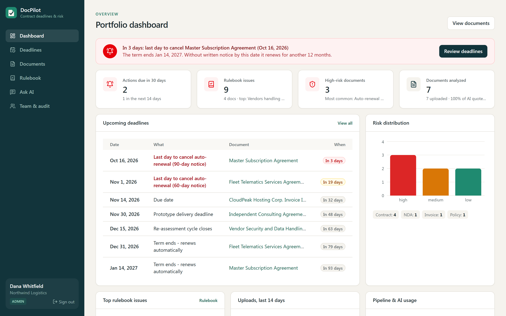
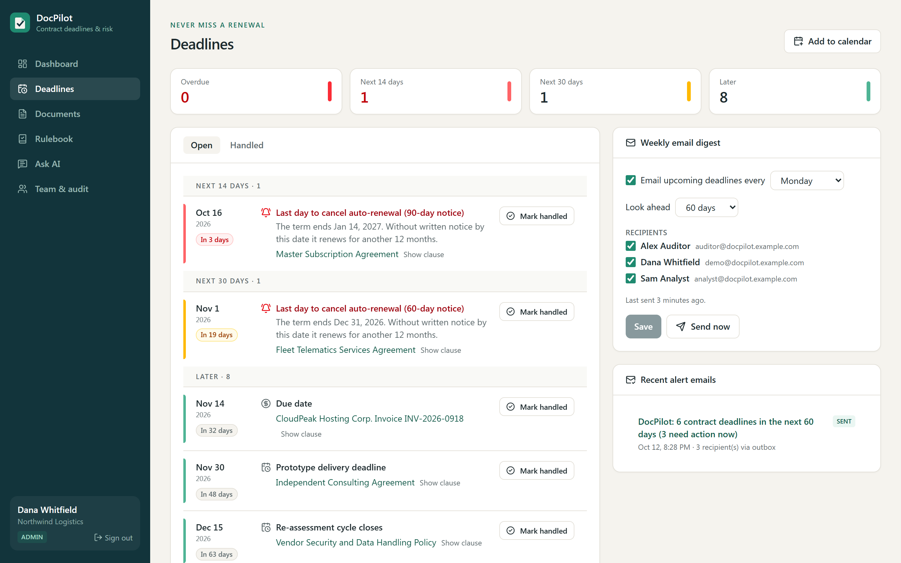
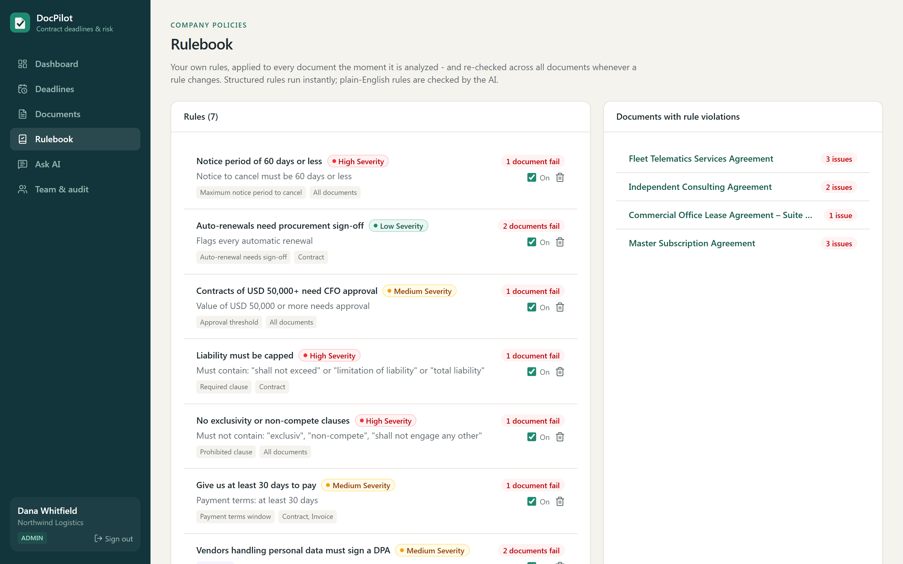
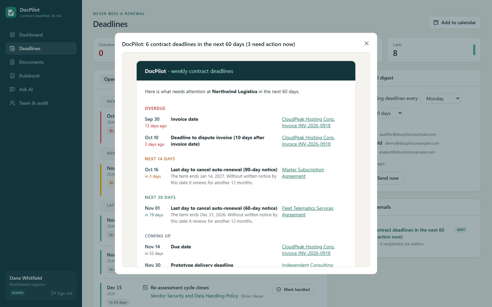
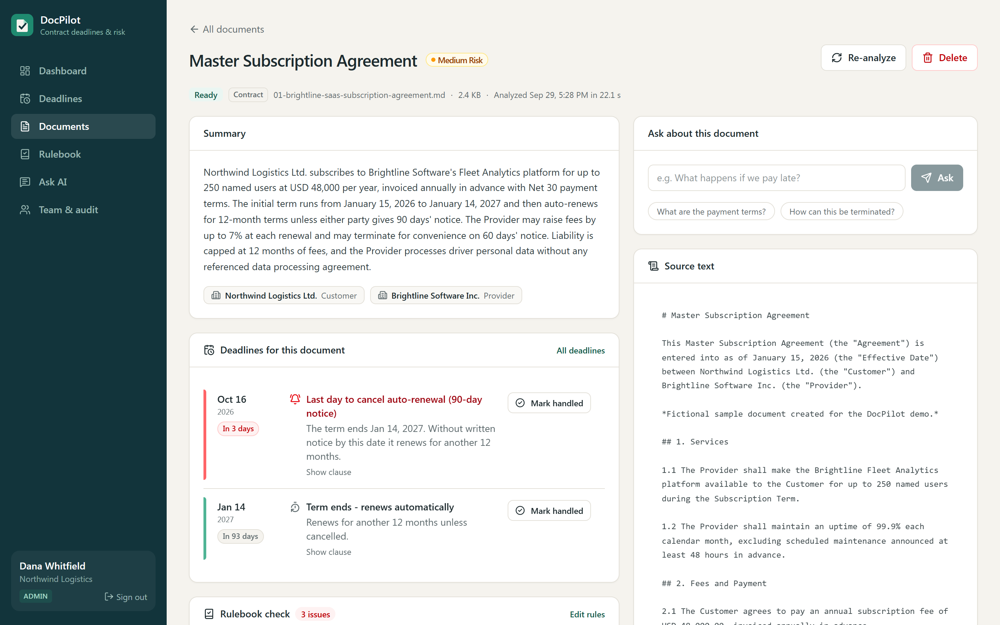
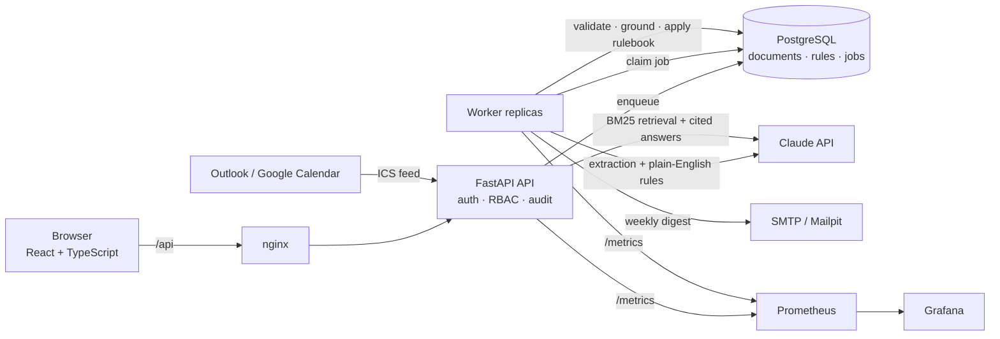

# DocPilot - AI contract review, deadlines & policy checks

[](https://github.com/Xiaohui-Lu/docpilot/actions/workflows/ci.yml)

### Never miss a contract renewal or notice deadline again.

**DocPilot is an AI contract assistant that _reviews_ every agreement, _tracks_ every deadline and _checks_ each contract against your company's own rules.**

| **Review** | **Track** | **Enforce** |
|---|---|---|
| AI reads each contract into structured data, flags risky clauses, verifies every quote and answers questions with citations. | Computes every deadline - including the _last day to cancel_ an auto-renewal, which appears nowhere in the document - and emails your team weekly, with a calendar feed. | Checks every agreement against your rulebook ("notice <= 60 days", "liability must be capped", "CFO approval over $50k"), including plain-English rules checked by AI. |



_Screenshots show real output from Claude (`claude-opus-5-5`) on the 7 fictional sample documents. Analyzing all 7 and answering 4 questions cost about $0.44 in API usage._

> Portfolio project by **Xiaohui Lu** - senior full-stack / DevOps engineer. It shows how I turn an LLM feature into a product people can rely on: structured, verified AI output feeding scheduled workflows, alerts, policy checks, multi-tenancy, observability, tests and deployment.

---

## The problem

Small and mid-sized companies sign far more agreements than anyone re-reads: SaaS subscriptions, telematics and fleet services, leases, consultants, vendor NDAs. The expensive mistakes are rarely in the fine print people argue about - they are **dates**:

- A software subscription auto-renews for another year because nobody gave **90 days' notice** before the term ended.
- A supplier's Net 15 terms quietly break the company's 30-day payment policy.
- A consultant contract includes an exclusivity clause nobody approved.

Large companies buy contract-management suites for this. Smaller teams use a spreadsheet - or nothing.

### Why not just paste the contract into ChatGPT / Claude?

For reading one document once, a chat assistant is great. DocPilot is for the part chat can't do: **remembering, watching and reminding**.

| Chat assistant | DocPilot |
|---|---|
| Answers the question you thought to ask | Reads every document the same way and builds a deadline calendar automatically |
| You have to remember to ask again next quarter | Weekly email digest + calendar feed with reminders 7 days ahead |
| Doesn't know the term end minus the notice period is the real deadline | Computes the **last day to cancel** for every auto-renewal |
| Generic advice | Checks every agreement against **your** rulebook ("notice <= 60 days", "liability must be capped", "CFO approval over $50k") |
| Prose answers, one person's chat history | Structured data, CSV export, shared workspace with roles and an audit log |
| Contracts pasted into a consumer tool | Runs in your own infrastructure; every AI quote is verified against the source |

## Features

### Review

| | |
|---|---|
| **Structured AI extraction** | Each document becomes validated JSON: type, parties, dates, amounts, payment terms, renewal terms, obligations, risks with severity. |
| **Hallucination guard** | Every clause the model quotes is checked against the source text; unverified quotes are flagged. |
| **Cited Q&A (RAG)** | Ask across all documents or one document; answers cite the passage, one click highlights it. |

### Track

| | |
|---|---|
| **Deadlines & cancel-by alerts** | Every actionable date across all documents, plus computed cancel-by dates for auto-renewals, grouped by urgency (overdue / 14 days / 30 days / later). Mark items handled with a note; everything is audited. |
| **Weekly email digest** | Per-organization schedule (weekday, look-ahead window, recipients). Rendered HTML + plain-text email via SMTP (SES, SendGrid, Postmark...), or a local outbox / Mailpit inbox in development. |
| **Calendar feed** | A private, revocable iCalendar (ICS) URL - subscribe in Outlook, Google or Apple Calendar; reminders 7 days before each deadline. |

### Enforce

| | |
|---|---|
| **Company rulebook** | Structured rules (max notice period, auto-renewal sign-off, payment-terms window, approval thresholds, required / prohibited clauses) run instantly and deterministically; **plain-English rules** ("vendors handling personal data must sign a DPA") are evaluated by Claude during extraction. Changing a rule re-checks every document. |

### For teams

| | |
|---|---|
| **Teams** | Organizations (multi-tenant), admin / member / viewer roles, audit log, CSV export. |

| Deadlines & weekly digest | Rulebook |
|---|---|
|  |  |
|  |  |

## Engineering highlights

- **LLM output you can build workflows on.** Claude returns JSON-schema structured output (including renewal terms and per-rule policy verdicts), validated by Pydantic business rules. Invalid output is retried, refusals are not, oversized documents are rejected - never silently truncated - and every quote is grounded against the source.
- **Deterministic where it matters.** Deadlines are computed in code from extracted facts (term end - notice period), and structured rules run without a model call - consistent, instant, free and unit-tested. The model is used for reading, not for arithmetic.
- **Durable background processing.** A PostgreSQL-backed job queue runs document processing and scheduled digests: atomic claims across worker replicas, exponential backoff, retry budgets, stale-lock recovery, and duplicate-send protection.
- **Tenant isolation by construction.** Every query, retrieval, rule and calendar feed is scoped to the organization; cross-tenant IDs return 404. Covered by tests.
- **Observability.** JSON logs with request IDs, Prometheus metrics (HTTP, jobs, queue depth, LLM latency / tokens / cost), alert rules, Grafana dashboard.
- **Runs offline.** A rule-based demo provider implements the same interface, so the product and CI run with no API key and zero cost.
- **Tested.** 59 backend tests (SQLite and PostgreSQL in CI), frontend unit tests, Playwright E2E covering upload -> deadlines -> mark handled -> rulebook.

## Architecture



## Tech stack

| Layer | Technology |
|---|---|
| Frontend | React 19, TypeScript, Vite, Tailwind CSS v4, TanStack Query, React Router, Recharts |
| Backend | Python, FastAPI, SQLAlchemy 2, Pydantic v2, PyJWT, pypdf, SMTP, iCalendar |
| AI | Anthropic Claude (`claude-opus-5-5` by default): JSON-schema structured outputs, document citations, refusal fallback |
| Data | PostgreSQL (SQLite for local dev/tests) |
| Ops | Docker, docker-compose (Postgres, Mailpit, Prometheus, Grafana), Kubernetes (kustomize, HPA, PDB, probes), GitHub Actions |
| Testing | pytest, Vitest + Testing Library, Playwright |

## Run it locally (no Docker, no API key)

```bash
# Backend
cd backend
python -m venv .venv && .venv/Scripts/activate        # macOS/Linux: source .venv/bin/activate
pip install -r requirements-dev.txt
python scripts/seed.py                                  # demo workspace, 7 sample documents, starter rulebook
uvicorn app.main:app --reload --port 8000               # API docs at http://localhost:8000/docs

# Frontend (second terminal)
cd frontend
npm install
npm run dev                                             # http://localhost:5173
```

Sign in with the demo accounts listed in [`backend/scripts/seed.py`](backend/scripts/seed.py). Sample documents in [`samples/`](samples) are fictional. Without SMTP settings, digest emails are written to `backend/outbox/*.eml` and are viewable in the app (Deadlines -> Recent alert emails).

### Use Claude instead of the offline demo model

```bash
export DOCPILOT_LLM_PROVIDER=claude
export ANTHROPIC_API_KEY=...                  # or sign in with `ant auth login`
export DOCPILOT_LLM_MODEL=claude-opus-5-5     # optional
```

Plain-English rulebook rules are only evaluated in Claude mode. Token usage and estimated cost are tracked per document and question.

## Run the full stack with Docker

```bash
cp .env.example .env        # set DOCPILOT_JWT_SECRET (and optionally Claude / SMTP settings)
docker compose up --build
```

| Service | URL |
|---|---|
| Web app | http://localhost:8080 |
| API + OpenAPI docs | http://localhost:8000/docs |
| Mailpit (digest emails) | http://localhost:8025 |
| Prometheus / Grafana | http://localhost:9090 / http://localhost:3000 |

## Deploy to Kubernetes

```bash
kubectl -n docpilot create secret generic docpilot-secrets ...   # see deploy/k8s/secret.example.yaml
kubectl apply -k deploy/k8s
```

Separate API / worker / web Deployments, migrate Job, probes, resource limits, HPAs, PDB, TLS Ingress, non-root read-only containers (restricted Pod Security). On AWS: EKS + RDS PostgreSQL + SES for email + ECR images built by CI.

## Tests

```bash
cd backend && pytest                                   # 59 tests; set TEST_DATABASE_URL to run on PostgreSQL
cd frontend && npm test && npm run typecheck           # unit tests + strict TypeScript
cd frontend && npx playwright test                     # E2E against a real API + worker + UI
```

CI ([`.github/workflows/ci.yml`](.github/workflows/ci.yml)) runs lint, backend tests on SQLite and PostgreSQL, frontend checks, Playwright E2E and builds both container images on every push (set the repository variable `PUSH_IMAGES=true` to publish images to GHCR).

## Project structure

```
backend/app/
  api/            auth, documents, deadlines (+ ICS feed), rules, notifications, ask (RAG), analytics, admin
  services/
    llm/          provider interface, Claude implementation, offline demo provider
    pipeline.py   parse -> chunk -> extract (+ AI rules) -> validate -> ground -> apply rulebook -> persist
    deadlines.py  action items, computed cancel-by dates, iCalendar export
    rules.py      company rulebook: deterministic rule kinds + AI-evaluated instructions
    notifications.py  weekly digest: build, deliver (SMTP / outbox), schedule
    jobs.py       durable job queue: claims, retries, backoff, stale-lock recovery
frontend/src/pages/  Dashboard, Deadlines, Documents, Document detail, Rulebook, Ask, Team & audit
deploy/          Kubernetes, Prometheus rules, Grafana dashboard
samples/         fictional contracts, NDA, invoice, lease, policy, telematics agreement
```

## Next steps toward production

- Ingest automatically from a shared mailbox or Google Drive / SharePoint folder.
- Slack / Teams notifications alongside email; per-user digest preferences.
- Alembic migrations; S3 storage for originals; OCR for scanned PDFs; hybrid BM25 + pgvector retrieval.
- SSO (OIDC) and per-tenant rate limits.
